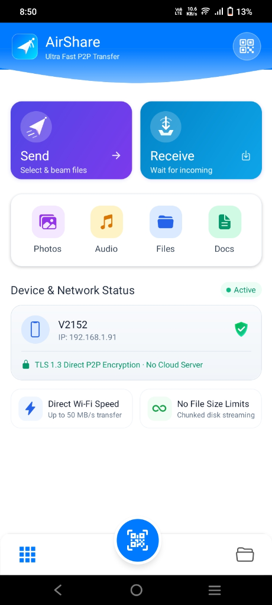
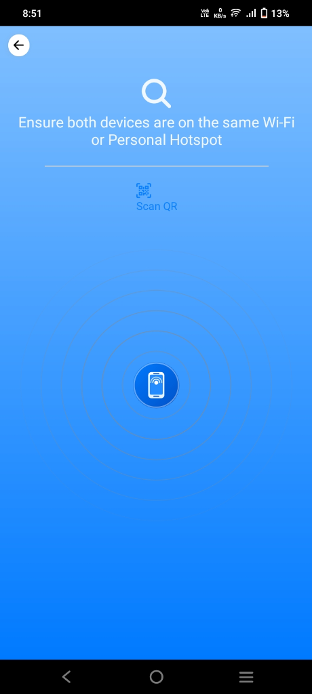
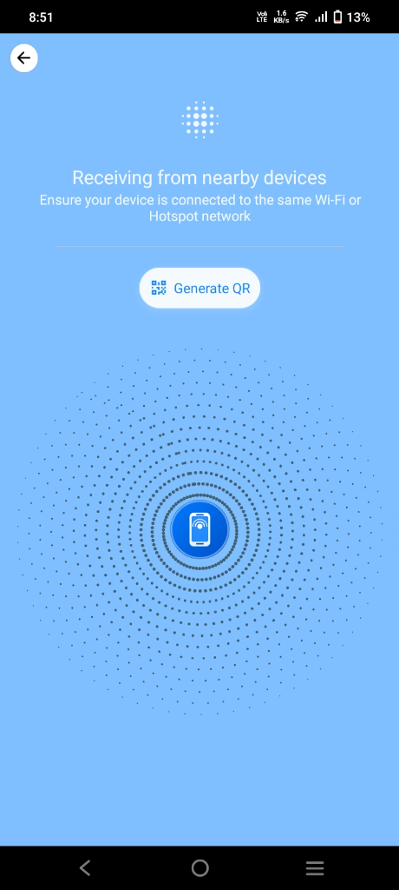
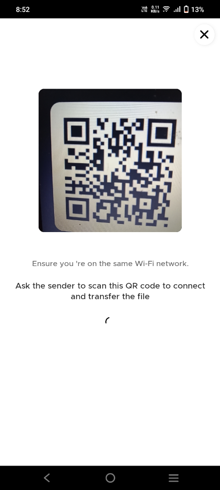
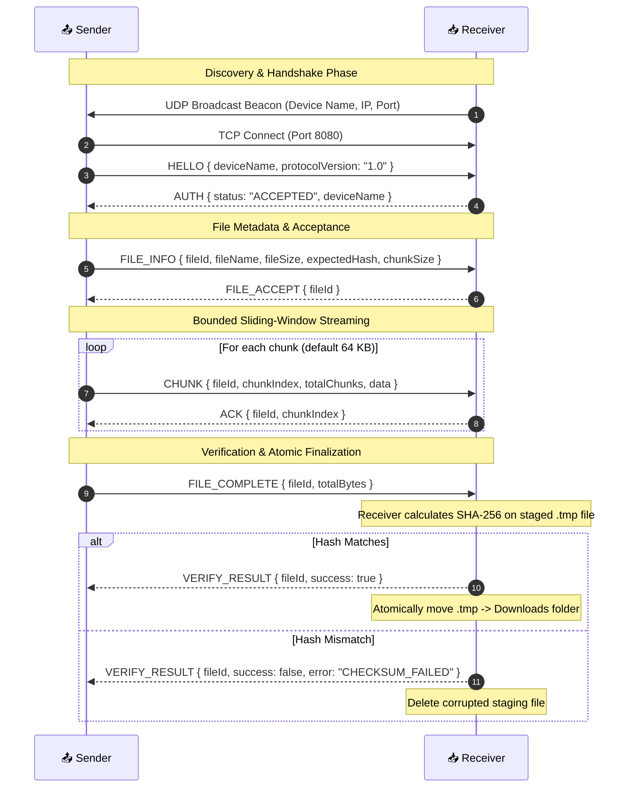

<div align="center">

# 🚀 AirShare

### Ultra-Fast, Secure, Peer-to-Peer Local Network File Sharing

[](https://reactnative.dev/)
[](https://www.typescriptlang.org/)
[](https://hermesengine.dev/)
[](https://jestjs.io/)
[](https://github.com/Ramanand-tomar/File-Sharing-App-with-TCP-UDP/actions)
[](https://opensource.org/licenses/MIT)

**AirShare** is an open-source, production-grade mobile peer-to-peer (P2P) file sharing application built with React Native and TypeScript. It enables blazing-fast, direct device-to-device file transfers across local Wi-Fi or Personal Hotspots at speeds up to **50+ MB/s** — **without internet access, cloud servers, or third-party tracking**.

[📥 Download Latest APK](https://drive.google.com/file/d/1GwXxvr8agXpKAxB1K8ooUXjRkevE5eCq/view?usp=drive_link) • [⚡ Key Features](#-key-features) • [📱 App Screenshots](#-app-screenshots) • [🏗️ Architecture & Protocol](#-architecture--protocol-specification) • [🚀 Getting Started](#-getting-started)

</div>

---

## 📱 App Screenshots

<div align="center">

| 📱 Home Dashboard | 📡 Sender Radar Discovery | 📥 Receiver Active Mode | 🔲 QR Fast Connect |
|:---:|:---:|:---:|:---:|
|  |  |  |  |
| *One-tap Send/Receive & live network IP* | *Subnet UDP ping with animated radar* | *Listening beacon & incoming transfers* | *Zero-config direct camera handshake* |

</div>

---

## ⚡ Key Features

- **🚀 Direct High-Speed TCP Transfer:** Bypasses slow Bluetooth and internet bandwidth limits by streaming files directly between devices over local TCP sockets (achieving up to 50 MB/s on 5 GHz Wi-Fi).
- **📡 Subnet-Aware UDP Auto-Discovery:** Employs dynamic subnet broadcasting (`192.168.x.255`, `192.168.43.255` for mobile hotspots) to detect nearby peers without requiring manual IP entry.
- **🔲 Instant QR Code Handshake:** Pair devices in under a second using direct camera QR code scanning when broadcast traffic is restricted by router client isolation.
- **💾 Zero-Memory Disk Streaming:** Files are read from disk in bounded chunks and streamed directly to the socket, allowing transfers of multi-gigabyte 4K videos, zip files, and ISOs without JavaScript heap exhaustion.
- **🔒 End-to-End Native SHA-256 Integrity:** Calculates cryptographic hashes before transfer and verifies them byte-for-byte upon receipt using an atomic two-stage staging strategy (`.tmp` → verification → final download).
- **📊 Real-Time Telemetry & Metrics:** Live calculation of transfer speeds (MB/s), estimated time of arrival (ETA), and chunk-by-chunk progress tracking.
- **🛡️ Hardened Security & Sanitization:** Strict path traversal protection prevents directory injection attacks (`../` stripping and illegal filename sanitization).
- **🎨 Modern Glassmorphism UI:** Built with custom vector SVGs, smooth Reanimated 4 transitions, and responsive typography.
- **📦 100% Standalone APKs:** Pre-compiled Hermes bytecode packaged directly into release builds — runs anywhere without Metro bundler or development tooling.

---

## 🏗️ Architecture & Protocol Specification

AirShare is architected with strict separation of concerns between raw binary transport, application state, and UI rendering.

```
┌────────────────────────────────────────────────────────┐
│                   React Native UI                      │
│     (HomeScreen / SendScreen / ReceiveScreen / QR)     │
└──────────────────────────┬─────────────────────────────┘
                           │ Zustand State
┌──────────────────────────▼─────────────────────────────┐
│                 FileTransferManager                    │
│   (Streaming, Sliding-Window, Hash Verification)       │
└──────────────────────────┬─────────────────────────────┘
                           │ Framed Messages & Binary Chunks
┌──────────────────────────▼─────────────────────────────┐
│             Length-Prefixed FrameParser                │
│       [ 4-byte uint32 payload length ][ payload ]      │
└──────────────────────────┬─────────────────────────────┘
                           │ TCP Byte Stream
┌──────────────────────────▼─────────────────────────────┐
│                  Native TCP Socket                     │
│               (react-native-tcp-socket)                │
└────────────────────────────────────────────────────────┘
```

### 1. Framed Binary Message Protocol
TCP is a continuous byte stream without inherent message boundaries. AirShare implements a robust **length-prefixed framing protocol** to eliminate packet fragmentation and coalescence bugs:

```
+-----------------------------+------------------------------------+
|  4-Byte Big-Endian uint32   |        Payload Data (N Bytes)      |
|     (Payload Length N)      |  (JSON Control Message / File Part)|
+-----------------------------+------------------------------------+
```

The receiver maintains a persistent buffer (`FrameParser.ts`), reads the 4-byte prefix, validates the length, and only extracts the complete payload once all bytes are accumulated.

### 2. Protocol Message Flow



---

## 🛠️ Tech Stack & Dependencies

| Category | Technology | Purpose |
|:---|:---|:---|
| **Core Framework** | [React Native 0.83](https://reactnative.dev/) | Cross-platform mobile runtime with New Architecture & Hermes |
| **Language** | [TypeScript 5.x](https://www.typescriptlang.org/) | Strict type safety across network payloads and state models |
| **State Management**| [Zustand 5](https://github.com/pmndrs/zustand) + [Immer](https://immerjs.github.io/immer/) | High-performance atomic UI updates without unnecessary re-renders |
| **Networking** | `react-native-tcp-socket` | Raw TCP server & client socket connections |
| **Peer Discovery** | `react-native-udp` | Local subnet UDP broadcast transmitter and listener |
| **IP Management** | `react-native-network-info` | Automatic Wi-Fi IPv4 address resolution |
| **File I/O** | `react-native-fs` & `react-native-blob-util` | Zero-memory chunked file reads, stream writing, and SHA-256 hashing |
| **QR Handshake** | `react-native-qrcode-svg` & Vision Camera | High-density QR code generation and instant camera scanning |
| **Animations & UI**| `react-native-reanimated 4` & `react-native-svg` | 60 FPS radar ripples, smooth transitions, and resolution-independent vector graphics |
| **Testing** | [Jest](https://jestjs.io/) | Full unit test coverage of protocol framing, sliding-window, and file pipelines |

---

## 📂 Project Structure

```
Sharing_App_TCP/
├── .github/
│   └── workflows/
│       └── build-android.yml         # Cloud CI/CD: Automated APK build & release
├── docs/
│   └── screenshots/                  # High-resolution application screenshots
├── src/
│   ├── components/                   # Reusable UI components
│   │   ├── home/                     # Header, Category Options, Send/Receive cards
│   │   ├── modals/                   # QR code generation & connection dialogs
│   │   ├── radar/                    # Animated pulsing radar & wave ripples
│   │   └── svgs/                     # Custom vector SVGs (Logo, Shields, Radars)
│   ├── navigation/                   # React Navigation 7 stack router
│   ├── protocol/                     # Binary framing & protocol specifications
│   │   ├── FrameParser.ts            # Length-prefixed buffer accumulator
│   │   ├── FramedSocket.ts           # Framed TCP socket wrapper
│   │   └── ProtocolMessages.ts       # Strongly typed protocol message definitions
│   ├── screens/                      # Primary application screens
│   │   ├── HomeScreen.tsx            # Main dashboard & live network overview
│   │   ├── SendScreen.tsx            # Outgoing radar & file picker pipeline
│   │   ├── ReceiveScreen.tsx         # Incoming radar & listening coordinator
│   │   └── ReceivedFileScreen.tsx    # Downloaded file gallery & manager
│   ├── services/                     # Core background services
│   │   ├── FileTransferManager.ts    # Streaming, SHA-256 verification, temp staging
│   │   ├── TCPProvider.tsx           # TCP socket lifecycle & state synchronization
│   │   └── TCPUtils.tsx              # Native hashing, chunk utilities, safe file naming
│   ├── store/                        # Zustand stores (Transfer & UI state)
│   ├── types/                        # Global TypeScript interfaces & navigation types
│   └── utils/                        # Network IP discovery & telemetry math
├── __tests__/                        # Comprehensive Jest test suites (31 unit tests)
│   ├── protocol/                     # Framing & packet parser tests
│   ├── services/                     # File streaming & hash validation tests
│   └── utils/                        # Network broadcast & telemetry speed tests
├── android/                          # Native Android Gradle configuration
└── package.json
```

---

## 📥 Download Standalone APK & Quick Testing

No laptop, USB cable, or Metro bundler is needed to test or use AirShare.

### Direct Download:
👉 [**Download AirShare Release APK (`app-release.apk`)**](https://github.com/Ramanand-tomar/File-Sharing-App-with-TCP-UDP/releases)

### 3-Step Setup Between Two Android Phones:
1. **Install `app-release.apk`** on both devices.  
   *(If prompted, allow "Install Unknown Apps" from your file manager/browser).*
2. **Connect to the Same Network:**
   - Connect both devices to the same Wi-Fi router, **OR**
   - Turn on **Personal Hotspot** on Phone A and connect Phone B to it (zero cellular data used).
3. **Beam Files:**
   - On **Device A (Receiver)**: Tap **Receive** (radar discovery starts).
   - On **Device B (Sender)**: Tap **Send**, choose photos, videos, or documents, and tap Device A on the radar screen.
   - Files are verified with SHA-256 upon completion and saved directly to your phone's **Downloads** folder!

---

## 💻 Local Development Setup

### Prerequisites
- **Node.js**: >= 20.x
- **Java Development Kit (JDK)**: Temurin 17
- **Android SDK**: Build-Tools `35.0.0`, Platform `android-35`, NDK `27.1.12297006`

### 1. Clone & Install Dependencies
```bash
git clone https://github.com/Ramanand-tomar/File-Sharing-App-with-TCP-UDP.git
cd File-Sharing-App-with-TCP-UDP/Sharing_App_TCP
npm install
```

### 2. Start Metro Bundler
```bash
npx react-native start
```

### 3. Connect via ADB & Run
For USB or Wireless ADB:
```bash
# Reverse port 8081 for Metro bundler
adb reverse tcp:8081 tcp:8081

# Launch on Android device
npx react-native run-android
```

---

## 🧪 Testing & Code Verification

AirShare enforces strict test-driven reliability for all network framing and file-system routines.

Run the full Jest test suite:
```bash
npm test
```

```
PASS  __tests__/utils/TransferMetrics.test.ts
PASS  __tests__/protocol/FrameParser.test.ts
PASS  __tests__/protocol/FramedSocket.test.ts
PASS  __tests__/services/FileTransferManager.test.ts
PASS  __tests__/utils/networkUtils.test.ts
PASS  __tests__/App.test.tsx

Test Suites: 6 passed, 6 total
Tests:       31 passed, 31 total
Snapshots:   0 total
Time:        16.031 s
```

Run TypeScript strict validation:
```bash
npx tsc --noEmit
```

---

## 🔄 Automated CI/CD Pipeline

Every push to the `main` branch triggers an automated build workflow on GitHub Actions (`.github/workflows/build-android.yml`):
- Sets up JDK 17 & Node.js 20 in an Ubuntu environment.
- Accepts Android SDK licenses automatically.
- Compiles both **Release** (`assembleRelease`) and **Debug** (`assembleDebug`) standalone APKs.
- Automatically publishes a GitHub Release tagged `v1.0.0-release` with ready-to-install APK artifacts.

---

## 🔒 Security & Privacy

- **100% Offline & Air-Gapped:** Zero external server connections, telemetry, or analytics trackers.
- **Direct P2P Sockets:** Data travels solely across the local wireless link between the two peer IP addresses.
- **Cryptographic File Verification:** Receivers calculate SHA-256 checksums locally and reject corrupted or tampered files before moving them out of the `.tmp` staging sandbox.
- **Strict Directory Path Traversal Defense:** Prevents arbitrary file write exploits by stripping relative paths (`../`) and normalizing incoming filenames.

---

## 📄 License

This project is licensed under the [MIT License](LICENSE). You are free to use, modify, and distribute this software for personal or commercial projects.
